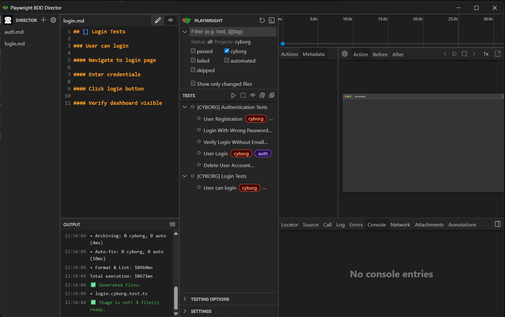

# 🎭 Playwright BDD Director

## Write the Script, We'll Play the Show

A Markdown-driven testing framework for Playwright that keeps cyborg (manual) and automated tests synchronized from a single source of truth.

Part of [CyborgTests](https://github.com/CyborgTests) - a modern testing ecosystem combining human insight with automation power.

## 🚀 Quick Start

### 1. Install Node.js

1. Open [Node.js Downloads](https://nodejs.org/en/download) in browser
2. Select your operating system and CPU architecture
3. Download the suggested version
4. Run the downloaded installer and follow the installation steps
5. Open a terminal and verify that Node.js was installed successfully:

```bash
node --version
```

### 2. Download Playwright BDD Director

Clone with Git:

1. Open a terminal in the folder where you want to clone the repository
2. Run the commands below:

```bash
git clone https://github.com/CyborgTests/playwright-bdd-director
cd playwright-bdd-director
```

or download ZIP:

1. Open the [repository page](https://github.com/CyborgTests/playwright-bdd-director) on GitHub
2. Click **Code** → **Download ZIP**
3. Extract the archive to any folder
4. Open a terminal in the extracted folder

### 3. Install dependencies

```bash
npm install
```

### 4. Build the Director UI

```bash
npm run build
```

This builds the Director UI (React/Vite) and patches Playwright to embed it into the Playwright UI interface.

### 5. Install Playwright browsers

```bash
npx playwright install
```

### 6. Launch the UI

```bash
npm run show
```

This opens the combined interface in your browser:

- **Director UI** (built as part of this project) - file explorer, Monaco editor, staging controls, test runner
- **Playwright UI** (built-in Playwright feature) - embedded for detailed test execution, traces, and screenshots

Together they form a unified workspace for the full testing workflow.


### 7. Create your first test suite

In the Director UI:

1. **File Explorer** - click **New File** button
2. Enter filename: `login.md`
3. **File Editor** - paste the following (saves automatically as you type):

```markdown
## [] Login Tests

### User can login

#### Navigate to login page

#### Enter credentials

#### Click login button

#### Verify dashboard visible
```

### 8. Stage your tests

Click **Stage** button in the Director UI toolbar (or run `npm run stage` in terminal).

This validates structure, generates test files, and keeps everything in sync.



### 9. Run tests

In the Director UI:

1. **Test Runner** - shows all generated tests
2. Select test type: **Cyborg**, **Auto**, **API**, or **UI**
3. Click **Run** next to any test or **Run All**

**Alternative - Terminal CLI:**

```bash
npm run play cyborg              # all cyborg (manual) tests
npm run play api                 # all automated API tests
npm run play ui                  # all automated UI tests
```

### 10. View detailed results

After tests finish, close the UI window - the terminal will become available again. Then open the HTML report:

```bash
npm run review
```

### 11. Check coverage

See which spec test cases are covered by cyborg, API, UI and E2E tests - no test run needed:

```bash
npm run matrix                           # console table
npm run matrix -- --html --json --md     # + test-results/coverage-matrix.{html,json,md}
npm run matrix -- --md=docs/coverage.md  # any format to a custom path
npm run matrix -- --min=80               # exit 1 when automated coverage is below 80%
```

```text
  Authentication Tests  test-suites/auth.md
  ████████████████████ 100% automated 5/5

    Test case                   Cyborg   API   UI   E2E
    User Registration           ✔ 0/3    ✔     ✔    —
    ...

  Total  7 test cases in 2 suite(s)
  Automated     ████████████████████ 100% 7/7
  Cyborg only   ░░░░░░░░░░░░░░░░░░░░   0% 0/7
  Uncovered     ░░░░░░░░░░░░░░░░░░░░   0% 0/7
  Cyborg steps  ░░░░░░░░░░░░░░░░░░░░   0% 0/19 without manualStep()
```

- **Cells**: ✔ implemented · ○ empty skeleton (AUTO from `autogen`) · ⊘ `skip`/`fixme` · — missing · `n/a` for `noCyborg` suites; colors in a terminal (off for pipes and `NO_COLOR`)
- **Cyborg cell** `✔ x/y` shows automated/total steps: a step counts as automated when it has no `manualStep()` inside
- **Automated case** = implemented in at least one of api/ui/e2e/auto; Background is shown but not counted
- **HTML** is a single self-contained file with filters (not automated / cyborg only / uncovered) and light/dark theme; **JSON** is the same data for CI, TMS or agents

## ⚡ Markdown-Driven Testing Platform

Playwright BDD Director is part of the [CyborgTests](https://github.com/CyborgTests) ecosystem - a suite of tools that combine human insight with automation power.

It brings together:

- Playwright for automated E2E, UI, and API testing
- `@cyborgtests/test` for cyborg (manual) test execution
- Markdown as the single source of truth
- Built-in Director UI for visual test management

The same Markdown spec keeps cyborg and automated test files synchronized.

## 💡 Why Markdown-First Testing?

### 1. Readable beyond engineering

Manual QA, managers, and non-technical stakeholders can review and update test specifications without touching TypeScript.

### 2. One spec file, multiple test implementations

The Markdown file is the **specification** - it defines what needs to be tested. Based on it, Playwright BDD Director generates and keeps in sync:

- **Cyborg test files** - ready to run immediately via Cyborgtests (manual execution)
- **Automated test skeletons** - structure generated, logic implemented by you

The MD file does not run tests - it keeps all implementations synchronized. When you change the spec, `npm run stage` propagates those changes across all test files automatically.

### 3. Works without automation

Playwright BDD Director already provides value for cyborg (manual) testing - automation can be added later if needed.

### 4. Built for Playwright

When automation is needed, the same Markdown structure scales naturally to Playwright E2E, UI, and API testing with full TypeScript support.

## 🤖 AI-Friendly by Design

Playwright BDD Director is designed to work naturally with AI coding assistants (GitHub Copilot, Cursor, Claude Code, etc.) inside your IDE.

The key advantage: **spec files and test files live in the same repository**. An AI assistant sees both at once - it can read `auth.md` and immediately understand what `auth.api.test.ts` is supposed to do, without any context switching.

This unlocks a practical workflow:

- **Write test cases with AI** - describe a feature, ask AI to generate the MD spec, run `npm run stage` to validate and generate test skeletons
- **Implement tests with AI** - AI reads the spec and the skeleton side by side, fills in the Playwright logic with full context
- **Review coverage with AI** - point AI at `test-suites/` and ask what scenarios are missing or which edge cases are not covered
- **Propagate spec changes with AI** - update the MD file with AI assistance, run `npm run stage`, and structural changes sync across all test files automatically

**Example workflow in Cursor or Copilot:**

```text
1. Ask AI to write test cases → saved directly to test-suites/auth.md
2. npm run stage → framework validates + generates test skeletons
3. Ask AI to implement steps → AI reads spec + skeleton, fills in the logic
4. npm run play auto → run tests
```

## 📐 Playwright BDD Director vs Cucumber vs Pure Playwright

| Feature            | Cucumber + PW | Pure Playwright | **PW BDD Director** |
| ------------------ | ------------- | --------------- | ------------------- |
| Main Runner        | Cucumber      | Playwright      | **Playwright**      |
| Native PW Features | Partial       | Full            | **Full**            |
| TypeScript Support | Medium        | Excellent       | **Excellent**       |
| Debugging          | Harder        | Excellent       | **Excellent**       |
| Readability        | High          | Medium          | **High**            |
| AI Friendliness    | Medium        | High            | **Very High**       |
| Runtime Complexity | High          | Low             | **Low**             |
| Performance        | Medium        | High            | **High**            |
| Maintenance Cost   | High          | Low             | Medium              |
| Flexibility        | Medium        | High            | **Very High**       |
| Visual UI          | No            | Basic           | **Advanced**        |

**Playwright BDD Director** is a modern middle-ground:

- Keeps **readable human-friendly scenarios** like Cucumber
- Keeps **native Playwright runner** with full TypeScript support
- Removes Cucumber pain points: regex step matching, runtime complexity, shared context chaos, heavy abstraction layers
- Adds **AI-native workflow** on top

Best for: modern Playwright projects, AI-assisted automation, teams that want readable scenarios without Cucumber complexity, projects needing visual test management.

## 🎨 Director UI

A combined visual interface - the Director UI (built in this project) together with Playwright UI (built-in Playwright feature) form a unified workspace:

**Director UI (our part):**

- **File Explorer** - browse and edit Markdown test suites with File Editor
- **Staging Controls** - run `stage` visually, see metrics and generated files

**Playwright UI (Playwright's part):**

- View all tests, run individually or in batches with real-time status
- Detailed test execution view with step-by-step breakdown
- Traces, screenshots, and video on failure

**Launch:**

```bash
npm run show
```

The combined UI makes it possible to manage the full testing workflow - from writing specs to reviewing results - without leaving the browser.


## 🎯 Core Idea

**1 Markdown file = 1 test suite**  
**Multiple implementations = always synchronized**

Staging the Play (`npm run stage`):

- Auto-fixes MD formatting issues
- Validates structure (duplicates, MD hierarchy, global IDs)
- Generates missing cyborg tests
- Archives orphaned tests (cyborg + empty auto)
- Auto-fixes cyborg tests to match Markdown
- Auto-fixes empty automated test skeletons (structure only, no logic yet)
- Formats and lints test files

The Auto Tests Generator (`npm run autogen`):

- Generates empty automated test skeletons for all specs that don't have them yet
- Run on-demand when a developer is ready to start automating - no point generating skeletons before that
- `npm run autogen -- --dry-run` lists the skeletons it would create without writing them

The Dress Rehearsal (`npm run dress`):

- Validates existing tests without modification
- Checks MD ↔ TS synchronization
- Reports all mismatches

```text
┌──────────────────────────┐
│  auth.md                 │  ← Single Source of Truth
│  ## [TS01] Auth Tests    │
│  ### [TC01-01] Register  │
│  #### Navigate           │
│  #### Fill form          │
│  #### Verify success     │
└────────────┬─────────────┘
             │
    ┌────────┴────────┐
    ▼                 ▼
Cyborg Tests      Auto Skeletons
(auto-fixed)      (fill in logic)
    │                 │
    └─────────┬───────┘
              ▼
        Validation
     (tags, IDs, sync)
```

## 📝 MD Format

### 1. Structure

```text
## Test Suite Title

### Test Case title

#### Step Title

- Optional details
- Test data
- Expected results

#### Another Step
```

### 2. Hierarchy

```text
## → Test Suite
### → Test Case
#### → Test Step
Lists (-) → Comments (ignored by validator)
--- → Optional separator between test cases (ignored by validator)
```

### 3. IDs - Optional but Powerful

IDs are optional. Tests work without them (validator matches by full titles).

**Why use IDs:**

- **Multiple implementations** - generate multiple tests from a single MD case
- **Stable matching** - titles can change, IDs remain constant
- **Avoid duplicates** - Markdown linters allow duplicate titles when IDs differ

**Suffix Support - Multiple Implementations:**

With IDs, you can create multiple test types for one MD test case. Suffix after ID is ignored during validation, allowing cyborg, auto, API, UI, and E2E implementations to match the same MD test case.

**ID Format (brackets only):**

✅ `### [TC01-01] Test Case title` - ID extracted, suffix support enabled  
✅ `### [] Test Case title` - empty ID, suffix-only support  
❌ `### TC01-01: Test Case title` - no ID, validates by full title  
❌ `### TC01-01 - Test Case title` - no ID, validates by full title

**Empty ID - Suffix Only:**

Use empty brackets `[]` when you only need suffixes to distinguish implementations:

```typescript
// One MD test case: ### [] User Registration

test('[CYBORG] User Registration', ...)  // Cyborg implementation (no dash)
test('[AUTO] User Registration', ...)    // Automated implementation (no dash)
test('[API] User Registration', ...)     // API implementation (no dash)
```

All three match `[]` from MD. Useful when you don't need numbered IDs, just implementation types.

**Without IDs:**

```markdown
### User Registration
```

Must match exactly in test file - no suffix support, no multiple implementations.

### 4. Gherkin (`.feature`) - Alternative Format

A suite can be written in Gherkin instead of Markdown - choose the format per file. `test-suites/navigation.feature` works exactly like an MD file: `stage` generates its cyborg test, `dress` checks the sync, `autogen` creates the AUTO skeleton, and Director UI edits and stages it.

```gherkin
Feature: Site Navigation

  Background:
    Given user opens the home page

  Scenario: Open "Signup / Login" page from header
    When user clicks "Signup / Login" button in header
    Then "Login to your account" form is visible
```

| Gherkin                                      | Test file                                                           |
| -------------------------------------------- | ------------------------------------------------------------------- |
| `Feature: [ID] Title`                        | `test.describe(...)` - IDs follow the MD convention                 |
| `Scenario: [ID] Title`                       | `test(...)`                                                         |
| step (`Given/When/Then/And/But text`)        | `test.step('Given ...')` / `manualStep('Given ...')` - keyword kept |
| `Background:`                                | `test.beforeEach('Background', ...)` with the background steps      |
| `Rule:`                                      | groups scenarios only                                               |
| descriptions, tags, data tables, doc strings | details, ignored by the validator                                   |

Steps are written in the test as in a Markdown suite - there are no step definitions or text matching at runtime. `Scenario Outline` is read as one test case for now (its examples are not used yet). Base names stay unique across formats: `auth.md` and `auth.feature` cannot coexist.

## ✅ Validation

### 1. What Validator Checks

```bash
npm run stage    # validate → generate → auto-fix → archive → format → lint
```

**Note:** Dress rehearsal (`npm run dress`) runs automatically before test execution to ensure synchronization.

Validator verifies:

1. **No duplicate MD base names** (e.g., two files named `auth.md`)
2. **Valid MD structure** (proper headings hierarchy, required sections)
3. **No duplicate IDs/titles** across all MD files (globally unique)
4. **MD ↔ TS synchronization** for each test file:
   - Suite title matches
   - Test case count and titles match
   - Step count and titles match per test case
   - IDs match (strict: MD is source of truth)
   - Tags match file type and basename

### 2. ID Validation Rules (Strict)

**MD is the source of truth:**

- If MD has ID → TS **must** have matching ID (error if missing)
- If MD has no ID → TS **must not** have ID (error if present)

**Brackets format with suffix support:**

Non-empty ID with dash before suffix:

- MD: `[TC01-01]` → Test: `[TC01-01]` ✅
- MD: `[TC01-01]` → Test: `[TC01-01-MANUAL]` ✅ (suffix with dash)
- MD: `[TC01-01]` → Test: `[TC01-01-AUTO]` ✅ (suffix with dash)
- MD: `[TC01-01]` → Test: `[TC01-02]` ❌ (different ID)
- MD: `[TC01-01]` → Test: no ID ❌ (missing ID)

Empty ID with suffix only (no dash):

- MD: `[]` → Test: `[MANUAL]` ✅ (suffix only, no dash)
- MD: `[]` → Test: `[AUTO]` ✅ (suffix only, no dash)
- MD: `[]` → Test: `[HYBRID]` ✅ (suffix only, no dash)
- MD: `[]` → Test: `[-MANUAL]` ❌ (dash not allowed with empty ID)
- MD: `[]` → Test: no ID ❌ (missing ID)

No ID:

- MD: no ID → Test: `[TC01-01]` ❌ (unexpected ID)

**Other formats** (`TC-001:`):

- Not recognized as IDs
- Validates full title only
- No suffix support

### 3. What Stage Auto-Fixes

**Automatically fixed:**

- MD formatting issues (trailing spaces, extra blank lines)
- Cyborg test structure (suite/test case/step titles)
- Missing test files (generates skeletons for cyborg + auto)
- Missing test cases and steps (inserted as skeletons at their MD position)

Test cases and steps are matched **by title or ID, not by position**: adding a case in the middle of MD inserts a skeleton there and never moves existing code under another title. A renamed case is updated in place only when the match is unambiguous (or the ID is the same). Cyborg tests structured with `test.step()` keep their steps as written - only test cases are synced.

**Reported, never changed automatically:**

- Test cases/steps removed from MD (code is kept for manual review)
- Test cases/steps reordered in MD (reorder manually)

`stage` lists every applied change under **Auto-fixed** and these warnings with ⚠️; a file with warnings only is left untouched and listed under **Needs manual review**.

**Must fix manually:**

- Tags (file type, suite tags from basename)
- IDs (add/remove to match MD)
- Duplicate IDs/titles across MD files

### 4. Orphaned Test Archiving

When MD file is deleted:

- **Cyborg tests** → archived to `tests/archived/` (preserves valuable manual work)
- **Empty automated tests** (API, UI, E2E, AUTO) → archived (no implementation to lose)
- **Implemented automated tests** → left in place (can continue running)

Archive location: `tests/archived/<filename>`.

### 5. Multiple Implementations

**With non-empty ID (dash before suffix):**

```typescript
// MD: ### [TC01-01] User Registration
test('[TC01-01-CYBORG] User Registration', ...)  // ✅ Matches [TC01-01]
test('[TC01-01-AUTO] User Registration', ...)    // ✅ Matches [TC01-01]
test('[TC01-01-API] User Registration', ...)     // ✅ Matches [TC01-01]
```

**With empty ID (suffix only, no dash):**

```typescript
// MD: ### [] User Registration
test('[CYBORG] User Registration', ...)  // ✅ Matches []
test('[AUTO] User Registration', ...)    // ✅ Matches []
test('[API] User Registration', ...)     // ✅ Matches []
```

Validator checks each `test()` separately against MD. Same file or different files - both are valid.

### 6. How Test Files Are Read

- A suite may span several top-level `test.describe` blocks (or be wrapped in an exported function); title and tags come from the first one
- Nested describes (`test.describe`, `.serial`, `.parallel`, `.skip`, `.fixme`, `.only`) only group tests - their titles are not MD entities
- Tests declared in a loop (`for...of`, `forEach`) count once, as written
- `test.use()`, `test.describe.configure()` and runtime modifiers (`test.skip(condition, reason)`, `test.slow()`) are not test cases
- **Named hooks are test cases**: `test.beforeAll('Create data', ...)` / `test.afterAll('Delete data', ...)` match MD test cases, and their `test.step()` titles match MD steps. Use them for setup/teardown that must run for any `--grep` subset. Unnamed hooks stay plain setup/teardown

```typescript
// MD: ### Create data → #### Create user | ### User Login | ### Delete data
test.beforeAll('Create data', async () => {
  await test.step('Create user', async () => { ... })
})
test('User Login', async () => { ... })
test.afterAll('Delete data', async () => { ... })
```

## 📁 Project Structure

```text
playwright-bdd-director/
├── test-suites/           # Markdown test suites (source of truth)
│   └── *.md               # Test specifications
├── tests/                 # Test implementations
│   ├── automated/         # Fully automated tests
│   │   ├── api/           # API tests
│   │   ├── ui/            # UI tests
│   │   ├── e2e/           # E2E tests
│   │   └── todo/          # AUTO test skeletons (generated)
│   ├── cyborg/            # Cyborg (manual) tests
│   ├── archived/          # Orphaned tests (auto-created)
│   └── unit/              # Framework unit tests
├── src/
│   ├── framework/         # Core framework code
│   │   ├── core/          # Parsers (md-parser, ts-parser, file-matcher)
│   │   ├── validation/    # Validators (sync-validator, md-validator, reporter)
│   │   ├── generation/    # Generators (test-generator, auto-fixer, test-archiver, tags-updater)
│   │   ├── reporting/     # Metrics and formatters (metrics, console-formatter)
│   │   ├── constants/     # Framework constants (markdown, test-files)
│   │   ├── errors/        # Error builders
│   │   ├── utils/         # Helpers (helpers, icons, ts-morph-helpers)
│   │   └── config.ts      # Framework configuration (env-overridable paths)
│   ├── clients/           # API clients (BaseClient, AuthClient)
│   ├── fixtures/          # Playwright fixtures (base, auth)
│   ├── pages/             # Page objects (BasePage, LoginPage, HomePage, SignupPage)
│   ├── schemas/           # API response schemas and types
│   ├── test-constants/    # Test tags
│   ├── test-helpers/      # Test-specific helpers (sanitize, playwright helpers)
│   └── test-utils/        # General test utilities (APIExpect, logger, schema-validator)
├── scripts/               # CLI tools
│   ├── play.ts            # Play CLI
│   ├── dress-rehearsal.ts # Validation script
│   ├── md-ts-director.ts  # Staging pipeline
│   ├── auto-skeletons.ts  # AUTO skeleton generator
│   └── patch-playwright.js # Playwright UI patch
├── packages/              # Director UI & Playwright integration
│   ├── director/          # Director UI (Vite + React)
│   └── trace-viewer/      # Enhanced Playwright trace viewer
└── tests/
    └── unit/              # Framework unit tests (290+ tests)
```

## 📚 Working Example

Repository includes a complete authentication example demonstrating:

- `test-suites/auth.md` - test cases with IDs for API and UI flows
- `tests/automated/api/auth.api.test.ts` - automated API tests
- `tests/automated/ui/auth.ui.test.ts` - automated UI tests
- `tests/cyborg/auth.cyborg.test.ts` - cyborg (manual) tests

All validate against the **same** `auth.md` - this demonstrates the framework.

**Run example:**

```bash
npm run stage             # Stage: validate → generate → auto-fix → archive → format → lint

# All tests (via Play CLI)
npm run play cyborg       # Play all cyborg tests (headed, workers=1)
npm run play auto         # Play all automated tests (headless, parallel)
npm run play api auth     # Play API auth tests only
npm run play ui auth      # Play UI auth tests only
npm run show              # Open Playwright UI mode (visual runner)
```

**Note:** Play CLI automatically runs dress rehearsal (validation) before executing tests.

## ⚙️ Configuration

### 1. File Naming

- **MD:** `<name>.md` (e.g., `auth.md`) in `test-suites/` or its subfolders; the base name must be unique across all of them
- **Subfolders** are mirrored by generated files: `test-suites/e2e/checkout.md` → `tests/cyborg/e2e/checkout.cyborg.test.ts` (and `tests/automated/todo/e2e/…` for `autogen`)
- **Test:** `<name>.<TYPE>.test.ts` (framework extracts base name before first dot)
- **Examples:**
  - `auth.cyborg.test.ts` → `auth.md` ✅
  - `auth.api.test.ts` → `auth.md` ✅
  - `auth.ui.test.ts` → `auth.md` ✅
  - `auth.auto.test.ts` → `auth.md` ✅

**Base name extraction:** Uses `getTestFileBaseName()` helper (`fileName.split('.')[0]`).

**Important:**

- `test-suites/` - only spec files (Markdown `.md` or Gherkin `.feature`)
- `tests/` - only test files (no helpers/utils)
- `tests/archived/` - orphaned tests (auto-created by Director)

### 2. Environment Variables

All paths support environment variable overrides via `src/framework/config.ts`:

| Variable               | Default                        | Description                                      |
| ---------------------- | ------------------------------ | ------------------------------------------------ |
| `TEST_SUITES_DIR`      | `test-suites`                  | Markdown test suites directory                   |
| `TESTS_DIR`            | `tests`                        | Root tests directory                             |
| `TESTS_AUTO_DIR`       | `tests/automated/todo`         | Generated AUTO test skeletons                    |
| `TESTS_CYBORG_DIR`     | `tests/cyborg`                 | Generated cyborg test skeletons                  |
| `TESTS_ARCHIVED_DIR`   | `tests/archived`               | Archived orphaned tests                          |
| `METRICS_ENABLED`      | `false`                        | Enable metrics JSON output                       |
| `METRICS_FILE`         | `.metrics.json`                | Metrics output file path                         |
| `COVERAGE_MATRIX_FILE` | `test-results/coverage-matrix` | Coverage matrix reports path (without extension) |

**Suites without cyborg tests:** list them in `CONFIG.noCyborg` (paths inside `test-suites/` without `.md`): a folder (`'api'`) covers all its MDs, a file (`'e2e/checkout'`) a single MD. `stage` neither generates nor auto-fixes cyborg files for them - they pair with automated tests only. An existing cyborg file is still checked by `dress`, so delete it.

### 3. Playwright Config

**Projects** (`playwright.config.ts`):

- `automated` - headless, parallel, trace + screenshot on failure
- `cyborg` - headless: false, workers: 1

Projects are selected dynamically based on the `--grep` tag argument.

### 4. Path Aliases

TypeScript path mapping configured in `tsconfig.json`:

```typescript
import { TAG } from '@/test-constants/tags'
import { AuthClient } from '@/clients/AuthClient'
```

`@/*` → `src/*` (use in tests, scripts, and framework code)

## 🧪 Development & Testing

### Unit Tests

The framework includes comprehensive unit tests for core components:

```bash
npm test              # Run tests in watch mode
npm run test:run      # Run tests once (CI mode)
npm run test:ui       # Open visual test UI
npm run test:coverage # Generate coverage report
```

**Test Coverage:**

- `md-parser.ts` - Markdown parsing logic
- `ts-parser.ts` - TypeScript AST parsing
- `file-matcher.ts` - MD ↔ TS validation
- `auto-fixer.ts` - Auto-fix logic
- `error-builders.ts` - Error message builders
- `icons.ts` - Console icons
- `sync-validator.ts` - Validation orchestration
- `tags-updater.ts` - Tag management

**Coverage Stats:**

- 290+ unit tests across 11 test files
- Critical modules: 90%+ coverage

### Play CLI

Unified command interface with built-in validation. Types and suites are freely combinable - specify any number of test types followed by any number of suite names:

```bash
npm run play <types...> [suites...]

# Single type
npm run play auto                   # All automated tests
npm run play cyborg                 # All cyborg tests
npm run play api                    # All API tests
npm run play ui                     # All UI tests

# Type + suite
npm run play cyborg auth            # Cyborg auth tests only
npm run play api auth               # API auth tests only
npm run play ui auth                # UI auth tests only

# Multiple types
npm run play api ui                 # All API + UI tests
npm run play cyborg auto            # All cyborg + automated tests

# Multiple types + suite
npm run play api ui auth            # API + UI tests for auth suite

# Suite only (no type filter)
npm run play auth                   # All auth tests (any type)
```

**Supported test types:** `auto`, `cyborg`, `api`, `ui`, `e2e`

**Features:**

- Automatic dress rehearsal before tests
- Freely combinable types and suites
- Argument order validation (types before suites)
- Clean console output
- Sequential execution for cyborg tests
- Help command: `npm run play -- --help`

**Console Output:**

```bash
✨  Running dress rehearsal...
✅  Validation passed

[Playwright test output]

✅  Curtain call!
```

### Staging Pipeline

The Director stages your tests with detailed feedback:

```bash
npm run stage
```

**Output:**

```bash
✨  Director staging the play...

🔧  Fixed formatting: test-suites/auth.md
✅  Generated: tests/cyborg/login.cyborg.test.ts
🔧  Auto-fixed CYBORG:
    • tests/cyborg/auth.cyborg.test.ts
        Test suite title: "[TS01] Old Title" → "[TS01] Authentication Tests"
        ⚠️  Extra test case "[TS01-TC09] Draft" (not in MD) - manual review needed

📊  Director Metrics:
    Total files: 1
    Valid: 4, Invalid: 0

    Phases:
    • MD Formatting: 0/1 fixed (20ms)
    • Validation: 130ms
    • Generation: 2 cyborg (20ms)
    • Archiving: 0 cyborg, 0 auto (4ms)
    • Auto-fix: 0 cyborg, 0 auto (19ms)
    • Format & Lint: 4773ms

    Total execution: 4983ms

✅  Stage is set! 4 file(s) ready.
```

### Development Commands

```bash
npm run stage        # Full staging pipeline
npm run dress        # Validation only (no changes)
npm run show         # Open Playwright UI mode (visual, interactive runner)
npm run lint:fix     # ESLint fix
npm run format       # Prettier format
```

## 🔧 Framework Core

### 1. Director (`scripts/md-ts-director.ts`)

Full staging pipeline (7 phases):

1. **Fix MD formatting** - auto-corrects spacing, blank lines
2. **Validate (critical errors)** - checks duplicates, MD structure, global IDs
3. **Generate missing tests** - creates skeletons for cyborg + auto
4. **Archive orphaned tests** - moves cyborg + empty auto/api/ui/e2e tests to `tests/archived/` when MD is deleted
5. **Auto-fix cyborg tests** - syncs structure with MD
6. **Auto-fix empty automated tests** - updates auto tests without implementation (all steps are TODO/empty)
7. **Format and lint** - runs Prettier + ESLint before final validation

### 2. Core Components

**Parsers (`src/framework/core/`):**

- `md-parser.ts` - extracts structure from Markdown (headings, IDs); includes file cache and path traversal protection
- `ts-parser.ts` - extracts structure from TypeScript via AST (ts-morph)
- `file-matcher.ts` - compares individual MD ↔ TS files; validates tags, IDs, titles, steps

**Validators (`src/framework/validation/`):**

- `sync-validator.ts` - orchestrates 4-step validation (duplicates → structure → global IDs → MD-TS sync)
- `md-validator.ts` - validates MD structure hierarchy; auto-fixes formatting
- `reporter.ts` - formats and displays validation errors with actionable fix hints

**Generators (`src/framework/generation/`):**

- `test-generator.ts` - generates missing cyborg/auto test skeletons
- `auto-fixer.ts` - AST-based auto-fix of test structure to match MD; preserves `-AUTO`/`-CYBORG` suffixes
- `title-aligner.ts` - matches test cases/steps to MD by title/ID (inserts, extras, moves) so auto-fix never relies on position
- `test-archiver.ts` - archives orphaned tests; detects all automated kinds (AUTO, API, UI, E2E)
- `tags-updater.ts` - adds new suite tags to `src/test-constants/tags.ts`

**Reporting (`src/framework/reporting/`):**

- `metrics.ts` - collects and formats staging metrics per phase
- `console-formatter.ts` - unified error group output with separators

**Utils (`src/framework/utils/`):**

- `helpers.ts` - `getTestFileBaseName`, `matchIDWithSuffix`, `hasAutomatedTestFile`, etc.
- `icons.ts` - emoji icons for console output
- `ts-morph-helpers.ts` - shared AST utilities (singleton Project, findDescribeCall, findTestCalls, findStepCalls)

**Test Utilities (`src/test-utils/`):**

- `APIExpect` - Playwright `APIResponse` wrapper with status, schema, and field assertions; lazy response parsing with caching
- `logger.ts` - attaches logs and files to Playwright test reports
- `schema-validator.ts` - lightweight Joi-like schema validator for API response validation; validates only required fields, zero runtime dependencies

**Test Helpers (`src/test-helpers/`):**

- `test.helpers.ts` - `sanitizeObject` for masking sensitive data (emails, passwords, tokens) in logs and reports; partial email masking preserves debuggability
- `playwright.helpers.ts` - `getProjectsFromGrep` for dynamic project selection based on `--grep` tags
- `object.helpers.ts` - `getNestedField` for safe deep property access

### 3. Supported Patterns

Handles:

- `test.describe()`, `test.describe.skip()`, custom fixture describes (`authTest.describe()`)
- `test()`, `test.only()`, `test.skip()`, `test.fixme()`
- `test.step()` and `manualStep()` (cyborg tests)
- ID suffix extraction (`[TC01-01-MANUAL]` matches `[TC01-01]`)
- Multiple implementations per MD test case (manual + auto + hybrid)
- Escape sequences in titles

## 🎓 Philosophy

### 1. MD is the source of truth

- **MD defines:** structure, titles, IDs, test case count
- **TS implements:** how to execute (cyborg/auto/api/ui/e2e)
- **Director ensures:** TS always follows MD (auto-fix for cyborg tests)
- **Validation is strict:** if MD has ID → TS must have it; if MD has no ID → TS must not have it

### 2. MD = what to test, code = how to test

- MD shows test structure (high-level, readable by anyone)
- Code shows implementation (details)
- Validator keeps them synchronized
- Auto-fixer updates cyborg tests automatically
- Cyborg work preserved via archiving

### 3. One MD file = One Test Suite

- Multiple test cases per file
- Multiple implementations per test case (cyborg, api, ui, e2e, auto)
- Logical grouping by feature/functionality

## 📊 Reports

### 1. View test results

```bash
npm run review    # Open Monocart HTML report (after test run)
npm run show      # Open Playwright UI mode (before/during test run)
```

### 2. Report includes

- Test execution summary
- Screenshots on failure
- Detailed step-by-step logs

### 3. Centralized Report Storage (Optional)

For teams needing centralized report storage, you can add:

- **[@cyborgtests/reporter-playwright-reports-server](https://www.npmjs.com/package/@cyborgtests/reporter-playwright-reports-server)** - Cyborgtests reporter integration
- **[Playwright Reports Server](https://github.com/CyborgTests/playwright-reports-server)** - Docker-based reports storage

## 📄 License

MIT

See also: `THIRD_PARTY_NOTICES.md` (licenses for dependencies like Cyborgtests and Monocart Reporter).
