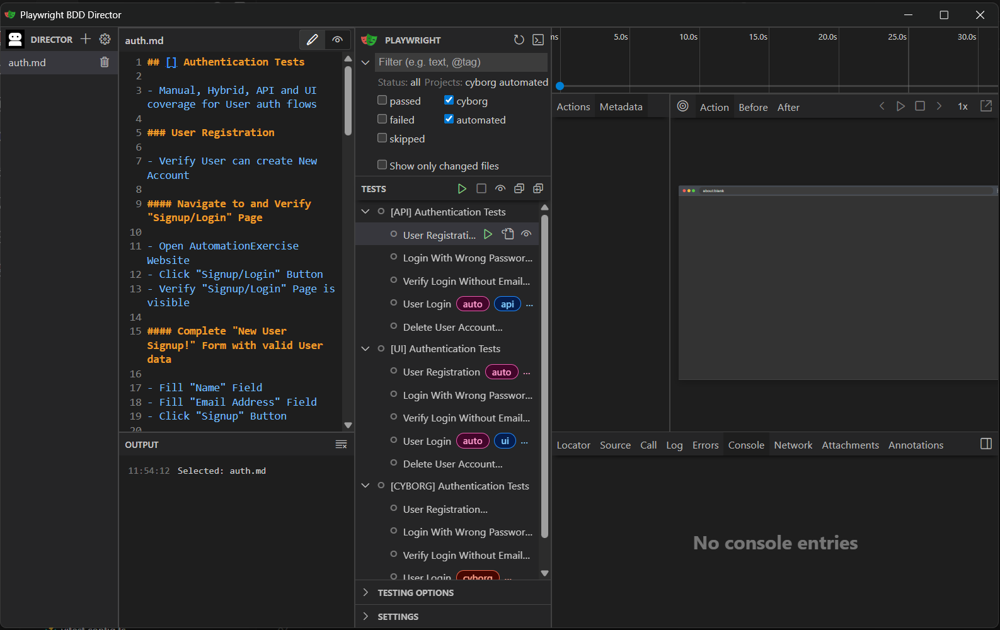

# 🎭 Playwright BDD Director

## Write the Script, We'll Play the Show

A spec-driven testing framework for Playwright: test cases are written in Markdown or Gherkin, each step is automated once by a step definition, and every test runs from day one - the steps without automation are walked by a person.

Part of [CyborgTests](https://github.com/CyborgTests) - a modern testing ecosystem combining human insight with automation power.

## 🚀 Quick Start

### 1. Install Node.js

1. Open [Node.js Downloads](https://nodejs.org/en/download) in browser
2. Select your operating system and CPU architecture
3. Download the suggested version
4. Run the downloaded installer and follow the installation steps
5. Open a terminal and verify that Node.js was installed successfully:

```bash
node --version
```

### 2. Download Playwright BDD Director

Clone with Git:

1. Open a terminal in the folder where you want to clone the repository
2. Run the commands below:

```bash
git clone https://github.com/CyborgTests/playwright-bdd-director
cd playwright-bdd-director
```

or download ZIP:

1. Open the [repository page](https://github.com/CyborgTests/playwright-bdd-director) on GitHub
2. Click **Code** → **Download ZIP**
3. Extract the archive to any folder
4. Open a terminal in the extracted folder

### 3. Install dependencies

```bash
npm install
```

### 4. Build the Director UI

```bash
npm run build
```

This builds the Director UI (React/Vite) and patches Playwright to embed it into the Playwright UI interface.

### 5. Install Playwright browsers

```bash
npx playwright install
```

### 6. Launch the UI

```bash
npm run show
```

This opens the combined interface in your browser:

- **Director UI** (built as part of this project) - file explorer, editor, staging controls
- **Playwright UI** (built-in Playwright feature) - test runner, traces and screenshots

Together they form a unified workspace for the full testing workflow.



### 7. Create your first test suite

In the Director UI:

1. **File Explorer** - click **New File** button
2. Enter filename: `login.md`
3. **File Editor** - paste the following (saves automatically as you type):

```markdown
## Login Tests

Tags: @ui

### User can login

#### Navigate to login page

#### Enter credentials

#### Click login button

#### Verify dashboard visible
```

`Tags: @ui` is the layer of the suite - every test is `@api`, `@ui` or `@e2e`.

### 8. Run it

The test is in the Playwright UI list right away - tests are generated from the specs on every run and every change. No step has a step definition yet, so it is a **cyborg test**: run it and the Cyborg Tests control panel walks you through the steps.

```bash
npm run play cyborg login        # the same from a terminal
```

### 9. Automate it step by step

```bash
npm run dress            # which steps a person still walks
npm run steps login      # step definition skeletons → src/steps/login.steps.ts
```

Implement a skeleton with Page Objects and its step runs automatically on the next run; once every step is implemented, the test is an automated test (`@auto`):

```typescript
Step('Navigate to login page', async ({ loginPage }) => {
  await loginPage.navigateToLogin()
})
```

```bash
npm run play auto login
```

### 10. View detailed results

After tests finish, close the UI window - the terminal will become available again. Then open the HTML report:

```bash
npm run review
```

Every run also writes reports for test management tools and CI:

- `test-results/cucumber-report.json` - **Cucumber JSON** (Xray, Zephyr Scale, ...) of every test, Markdown specs included: Feature / Background / Scenario (Outline) and steps come from the spec, step results from the run (manual steps too). Failed steps carry the error and screenshots. Xray links a scenario to its Jira test by a tag with the test key - use the format your Xray expects (often `@TEST_PROJ-123`): `Tags: @TEST_PROJ-123` in MD, `@TEST_PROJ-123` in Gherkin
- `test-results/cucumber-messages.ndjson` - **Cucumber messages**, the newer Cucumber format, and `test-results/cucumber-report.html` - the **Cucumber HTML report** rendered from them (one offline file)
- `test-results/junit.xml` - **JUnit XML** (TestRail, Zephyr, any CI)

### 11. Check coverage

See which tests are automated, which a person still walks and how many steps are automated - no test run needed:

```bash
npm run matrix                           # console table
npm run matrix -- --html --json --md     # + test-results/coverage-matrix.{html,json,md}
npm run matrix -- --md=docs/coverage.md  # any format to a custom path
npm run matrix -- --min=80               # exit 1 when automated tests are below 80%
npm run matrix -- @smoke                 # only tests tagged @smoke
```

```text
  Site Navigation  test-suites/navigation.md
  █████████████░░░░░░░  67% automated 2/3

    Test                                            Layer  Status      Steps auto
    Open "Signup / Login" Page from Header          UI     ✔ auto      4/4
    Return to Home Page from "Signup / Login" Page  UI     ✔ auto      4/4
    Subscribe to Newsletter from Footer             UI     ✋ cyborg    1/5

  Total  16 tests in 4 suite(s)
  Automated       ███████████████████░  94% 15/16
  Cyborg          █░░░░░░░░░░░░░░░░░░░   6% 1/16
  Fixme (API)     ░░░░░░░░░░░░░░░░░░░░   0% 0/16
  Disabled        ░░░░░░░░░░░░░░░░░░░░   0% 0/16
  Steps automated ██████████████████░░  91% 41/45
```

- **Status**: `auto` every step automated · `cyborg` a person walks the rest · `fixme` an API test waiting for step definitions · `disabled` `@skip` / `@fixme` / `@fail` in the spec
- **Steps auto**: automated / total steps of the test, Background included
- **HTML** is a single self-contained file with filters by status and light/dark theme; **JSON** is the same data for CI, TMS or agents

### 12. Run in CI

One command for any CI service (GitHub Actions, GitLab CI, Jenkins, Azure DevOps, ...):

```bash
npm ci                                # install dependencies
npx playwright install --with-deps    # browsers
npm run ci                            # dress -> automated tests -> coverage matrix
```

- `dress` fails first on invalid specs or ambiguous steps - no test runs then
- Runs every automated test (`play auto`); cyborg tests need a person and are skipped
- Failed tests do not stop the coverage matrix and reports; the exit code is 1 when any stage failed
- `CI_MIN_COVERAGE=80 npm run ci` also fails when automated tests are below 80%
- Keep `test-results/` as the job artifacts: `junit.xml` (most CI services show it as test results), `cucumber-report.{json,html}`, `cucumber-messages.ndjson`, `monocart-report/`, `coverage-matrix.{html,json,md}`

## ⚡ Spec-Driven Testing Platform

Playwright BDD Director is part of the [CyborgTests](https://github.com/CyborgTests) ecosystem - a suite of tools that combine human insight with automation power.

It brings together:

- Playwright for automated E2E, UI, and API testing
- `@cyborgtests/test` for the steps a person walks
- Markdown or Gherkin specs as the single source of truth
- Step definitions - each step automated once, reused everywhere
- Built-in Director UI for visual test management

## 💡 Why Spec-First Testing?

### 1. Readable beyond engineering

Manual QA, managers, and non-technical stakeholders can review and update test specifications without touching TypeScript.

### 2. One spec, one test - always in sync

The spec is the test: its tests are generated on every run, so they cannot drift from it. There are no test files to keep in sync, review for wording or archive.

### 3. Works before automation

A new spec runs at once as a cyborg test - a person walks its steps. Automation is added step by step: each implemented step definition stops asking a person on the next run, in every test that uses the step.

### 4. Built for Playwright

The generated tests are plain Playwright tests: fixtures, projects, traces, UI mode, the VS Code extension, parallel runs and reporters work as usual, with full TypeScript support.

## 🤖 AI-Friendly by Design

Playwright BDD Director is designed to work naturally with AI coding assistants (GitHub Copilot, Cursor, Claude Code, etc.) inside your IDE.

The key advantage: **specs and step definitions live in the same repository**. An AI assistant sees both at once - it reads `auth.md`, the list of steps without definitions from `npm run dress` and the Page Objects, and writes exactly the missing code.

- **Write test cases with AI** - describe a feature, ask AI to write the spec in `test-suites/`; it runs immediately as a cyborg test
- **Automate with AI** - `npm run steps <suite>` writes skeletons, AI implements them with Page Objects and clients
- **Review coverage with AI** - point AI at `test-suites/` and `npm run matrix -- --json` and ask what is missing

```text
1. Ask AI to write test cases → test-suites/auth.md
2. npm run play cyborg auth  → a person walks them today
3. npm run steps auth        → skeletons; ask AI to implement them
4. npm run play auto auth    → automated
```

## 📐 Playwright BDD Director vs Cucumber vs Pure Playwright

| Feature            | Cucumber + PW | Pure Playwright | **PW BDD Director** |
| ------------------ | ------------- | --------------- | ------------------- |
| Main Runner        | Cucumber      | Playwright      | **Playwright**      |
| Native PW Features | Partial       | Full            | **Full**            |
| TypeScript Support | Medium        | Excellent       | **Excellent**       |
| Debugging          | Harder        | Excellent       | **Excellent**       |
| Readability        | High          | Medium          | **High**            |
| AI Friendliness    | Medium        | High            | **Very High**       |
| Runtime Complexity | High          | Low             | **Low**             |
| Performance        | Medium        | High            | **High**            |
| Maintenance Cost   | High          | Low             | **Low**             |
| Flexibility        | Medium        | High            | **Very High**       |
| Visual UI          | No            | Basic           | **Advanced**        |
| Before automation  | Nothing runs  | Nothing runs    | **Cyborg tests**    |

**Playwright BDD Director** is a modern middle-ground:

- Keeps **readable human-friendly scenarios** like Cucumber - in Markdown or Gherkin
- Keeps **native Playwright runner** with full TypeScript support
- Removes Cucumber pain points: runtime complexity, shared context chaos, heavy abstraction layers
- Runs **unautomated steps by hand** instead of failing or skipping them
- Adds **AI-native workflow** on top

Best for: modern Playwright projects, teams moving from manual to automated testing, AI-assisted automation, teams that want readable scenarios without Cucumber complexity.

## 🎨 Director UI

A combined visual interface - the Director UI (built in this project) together with Playwright UI (built-in Playwright feature) form a unified workspace:

**Director UI (our part):**

- **File Explorer** - browse and edit Markdown and Gherkin specs with File Editor
- **Stage** - format the Markdown specs

**Playwright UI (Playwright's part):**

- View all tests, run individually or in batches with real-time status - the list follows the specs as you edit them
- Detailed test execution view with step-by-step breakdown
- Traces, screenshots, and video on failure

**Launch:**

```bash
npm run show
```


## 🎯 Core Idea

**1 spec file = 1 test suite = 1 generated test file**
**1 step = 1 step definition, reused by every test**

```text
┌──────────────────────────────┐     ┌──────────────────────────────┐
│ test-suites/navigation.md    │     │ src/steps/*.steps.ts         │
│ ## Site Navigation  @ui      │     │ Step('Open Home Page', …)    │
│ ### Open Signup Page         │     │ Step('Click {string} …', …)  │
│ #### Open Home Page          │     └──────────────┬───────────────┘
│ #### Click "Signup" Button   │                    │
│ #### Verify Form is visible  │                    │
└──────────────┬───────────────┘                    │
               └────────────┬───────────────────────┘
                            ▼  on every run
          .director/tests/navigation.test.ts (generated)
          test('Open Signup Page', { tag: ['@cyborg', '@ui'] }, …)
            await autoStep('Open Home Page', { homePage })     ← has a definition
            await autoStep('Click "Signup" Button', …)
            await manualStep('Verify Form is visible')         ← a person walks it
```

- A step with a step definition is **automated** (`autoStep`); without one - or with one without code - a **person walks it** (`manualStep`)
- A test with any manual step is a **cyborg test** (`@cyborg`, UI / E2E only): headed, one at a time, no time limit. A test with all steps automated is an **automated test** (`@auto`)
- An **API test** with a missing step stays `fixme` - nobody walks API by hand
- The Director commands:
  - `npm run dress` - read-only check: invalid specs, missing layers, ambiguous steps; steps a person walks; unused step definitions
  - `npm run steps <suite...>` - step definition skeletons for the steps without one
  - `npm run stage` - formats the Markdown specs (`---` before every test case)
  - `npm run play` - runs tests by type, suite and tag

## 📝 Specs

### 1. Markdown

```markdown
## Test Suite Title

Tags: @ui

- Optional details

---

### Test Case title

Tags: @smoke

#### Step Title

- Optional details, test data, expected results

#### Another Step
```

```text
## → Test Suite
### → Test Case (### Background - steps before every test case)
#### → Test Step
Tags: → tags of the suite / test case, right under its heading
Lists (-) → notes for people, not part of the test
--- → separator before every test case, placed by npm run stage
```

### 2. Gherkin

Any `.feature` file the Gherkin parser accepts: Background, Rule (with its own Background), Scenario Outline with Examples (tagged too), DataTable, DocString, `# language:`. Write the layer tag above `Feature:`:

```gherkin
@ui
Feature: Header Navigation
  Background:
    Given user opens the home page

  Scenario: Go back home from "Signup / Login" page
    Given user clicks "Signup / Login" button in header
    When user clicks "Home" button in header
    Then home page is shown
```

Both formats work the same way and can live side by side; pick per suite what reads best for its authors. Base names are unique across `test-suites/**` (`auth.md` and `auth.feature` cannot coexist) - the name is the suite tag (`npm run play auth`).

### 3. Layers

Every test is exactly one of `@api`, `@ui`, `@e2e`: a suite tag for all its test cases, a test case (Rule, Examples) tag overrides it. A test without a layer stops the run. Cyborg tests are UI or E2E only.

### 4. Tags

Tag a suite or a test case with a `Tags:` line right under its heading (Gherkin: `@tag` lines above `Feature` / `Rule` / `Scenario` / `Examples`):

```markdown
## Authentication Tests

Tags: @ui @auth-flow

### User Login

Tags: @smoke @JIRA-123
```

- Tags become Playwright tags of the generated tests, next to `@auto` / `@cyborg`, the layer and the suite tag `@<file name>`
- A tag starts with `@` followed by letters, digits, `_ . : / -`; several tags are separated by spaces or commas
- Background cannot be tagged (as in Gherkin)
- Special tags `@skip`, `@fixme`, `@fail`, `@slow`, `@retries:N`, `@timeout:N` become Playwright modifiers
- Run and measure by tag: `npm run play @smoke`, `npm run play ui auth @smoke`, `npm run matrix -- @smoke`

### 5. Parametrized test cases

A Markdown test case that runs once per data row gets an examples table right under its heading (after `Tags:`); its title and steps use `<column>` placeholders. In Gherkin it is a `Scenario Outline` with `Examples`.

```markdown
### Login as <role>

| role  | password |
| ----- | -------- |
| admin | secret   |
| guest | guest    |

#### Log in as "<role>" with "<password>"
```

- One test per row, title and steps filled with the row values: `Login as admin` runs `Log in as "admin" with "secret"`
- The title needs a placeholder of a column with unique values - Playwright requires unique test titles

### 6. IDs

Optional IDs in brackets stay in the test titles and reports: `## [TS01] Suite`, `### [TC01-01] Test case`. Test case IDs are unique within a spec; `[]` is an empty ID. Other formats (`TC-001:`) are part of the title.

### 7. Step definitions

```typescript
// src/steps/navigation.steps.ts
import { Given, Step } from './bdd' // createBdd(test) - typed with the project fixtures

const openHomePage = Given('user opens the home page', async ({ homePage }) => {
  await homePage.navigateToHome()
})

Step('Open Home Page', openHomePage) // Markdown wording of the same step
```

- **Patterns**: [Cucumber Expressions](https://github.com/cucumber/cucumber-expressions) or RegExp; the keyword does not affect matching; Markdown steps use `Step(…)`
- **Fixtures**: the first parameter destructures what the step needs; all steps of a test share the fixtures
- **No code** (empty body or comments only) = no definition: the step stays manual
- **Ambiguous step** → `dress` and the run fail with the definitions' locations; **unused definition** → `dress` warns
- **Hooks** `Before/After/BeforeAll/AfterAll/BeforeStep/AfterStep` with tag expressions (`@cyborg` matches the tests a person walks)
- **Step context** `bdd` next to the fixtures: tags, test title, step title, `skip()`, `attach()`, the step error in `AfterStep`
- **Migration**: existing Cucumber suites move over without rewriting their steps ([guide](docs/step-definitions.md#migrating-from-other-tools))

Full guide: [docs/step-definitions.md](docs/step-definitions.md).

## 📁 Project Structure

```text
playwright-bdd-director/
├── test-suites/           # Specs (source of truth): *.md, *.feature
├── src/
│   ├── steps/             # Step definitions (*.steps.ts) and hooks; bdd.ts binds them to the fixtures
│   ├── fixtures/          # Playwright fixtures (base, auth); index.ts - test of the generated tests
│   ├── pages/             # Page objects (BasePage, LoginPage, HomePage, SignupPage)
│   ├── clients/           # API clients (BaseClient, AuthClient)
│   ├── schemas/           # API response schemas and types
│   ├── test-helpers/      # Test-specific helpers (sanitize, playwright helpers)
│   ├── test-utils/        # General test utilities (APIExpect, logger, schema-validator)
│   ├── config/            # Playwright projects, devices
│   └── framework/         # The Director, unit tests (*.test.ts) next to the modules
│       ├── bdd/           # Step registry, generator, runtime (autoStep), build, skeletons
│       ├── core/          # Parsers (Markdown, Gherkin, spec document)
│       ├── validation/    # Markdown structure check and formatting
│       ├── reporting/     # Coverage matrix, Cucumber reports, console output
│       ├── constants/ errors/ utils/
│       └── config.ts      # Framework configuration (env-overridable paths)
├── scripts/               # CLI: play, dress, stage, steps, matrix, ci; generate-tests (run by the config)
├── packages/              # Director UI & Playwright integration
└── .director/tests/       # Generated tests (gitignored, rewritten on every run)
```

## 📚 Working Example

The repository automates [automationexercise.com](https://www.automationexercise.com):

- `test-suites/auth.md` (`@ui`) and `test-suites/auth-api.md` (`@api`) - the same auth rules through the browser and the API; `src/steps/auth.steps.ts`, `src/steps/auth-api.steps.ts`
- `test-suites/navigation.md` (Markdown) and `test-suites/header-navigation.feature` (Gherkin) - the same header flows in both formats, sharing step functions in `src/steps/navigation.steps.ts`; the newsletter test case has no step definitions yet, so it is a cyborg test
- `src/steps/hooks.steps.ts` - a hook attaching the page URL to failed UI tests

```bash
npm run dress             # specs and step definitions, what a person still walks
npm run play auto         # all automated tests (headless, parallel)
npm run play cyborg       # all cyborg tests (headed, one at a time)
npm run play api auth-api # API auth tests only
npm run play ui auth      # UI auth tests only
npm run show              # Playwright UI mode with the Director
```

## ⚙️ Configuration

### 1. Environment Variables

All paths support environment variable overrides via `src/framework/config.ts`:

| Variable                 | Default                                 | Description                                         |
| ------------------------ | --------------------------------------- | --------------------------------------------------- |
| `TEST_SUITES_DIR`        | `test-suites`                           | Specs directory                                     |
| `GENERATED_TESTS_DIR`    | `.director/tests`                       | Generated tests (Playwright `testDir`)              |
| `BDD_STEPS`              | `src/steps/**/*.steps.ts`               | Step definition files                               |
| `BDD_STEPS_DIR`          | `src/steps`                             | Where `npm run steps` writes skeletons              |
| `COVERAGE_MATRIX_FILE`   | `test-results/coverage-matrix`          | Coverage matrix reports path (without extension)    |
| `CUCUMBER_REPORT_FILE`   | `test-results/cucumber-report.json`     | Cucumber JSON of every run                          |
| `CUCUMBER_MESSAGES_FILE` | `test-results/cucumber-messages.ndjson` | Cucumber messages of every run                      |
| `CUCUMBER_HTML_FILE`     | `test-results/cucumber-report.html`     | Cucumber HTML report of every run                   |
| `JUNIT_REPORT_FILE`      | `test-results/junit.xml`                | JUnit XML of every run                              |
| `CI_MIN_COVERAGE`        | -                                       | `npm run ci` fails below this automated tests share |

### 2. Playwright Config

`playwright.config.ts` generates the tests when Playwright loads it (`prepareTests()`), then runs them in two projects selected by tag:

- `automated` - tests tagged `@auto`: headless, parallel, trace + video on failure
- `cyborg` - tests tagged `@cyborg`: headed, one worker, no time limit

`npm run play` builds the `--grep` and the project is chosen from it (`api` / `ui` / `e2e` alone run automated tests).

### 3. Path Aliases

`@/*` → `src/*` (`tsconfig.json`), in step definitions, fixtures, scripts and framework code:

```typescript
import { AuthClient } from '@/clients/AuthClient'
```

## 🧪 Development & Testing

### Play CLI

Types, suites and spec tags are freely combinable - test types first, then suite names (spec file names), spec tags (`@smoke`) anywhere:

```bash
npm run play <types...> [suites...] [@tags...]

npm run play auto                   # All automated tests
npm run play cyborg                 # All cyborg tests
npm run play api                    # Automated API tests
npm run play cyborg ui              # Cyborg UI tests
npm run play ui auth                # Automated UI tests of auth.md
npm run play api ui auth auth-api   # API + UI tests of two suites
npm run play auth                   # All tests of auth.md (any type)
npm run play @smoke                 # All tests tagged @smoke
npm run play ui auth @smoke         # UI auth tests tagged @smoke
```

**Supported test types:** `auto`, `cyborg`, `api`, `ui`, `e2e`. Help: `npm run play -- --help`.

### Director Commands

```bash
npm run dress        # check specs and step definitions (read-only)
npm run steps auth   # step definition skeletons for steps of auth.md without one
npm run stage        # format the Markdown specs
npm run show         # Playwright UI mode with the Director
npm run lint:fix     # ESLint fix
npm run format       # Prettier format
```

`dress` output:

```text
⚠️  test-suites/navigation.md: 4 step(s) walked by a person
    • Scroll down to Footer
    • Verify "Subscription" Heading is visible
    • Enter Email Address and click Arrow Button
    • Verify "You have been successfully subscribed!" Message is visible
    💡  Skeletons: npm run steps navigation

✅  4 spec(s) ready for the show: 16 tests - 15 auto, 1 cyborg, 0 fixme
```

### Unit Tests

```bash
npm test              # Run tests in watch mode
npm run test:run      # Run tests once (CI mode)
npm run test:ui       # Open visual test UI
npm run test:coverage # Generate coverage report
```

## 🔧 Framework Core

**Step definitions (`src/framework/bdd/`):**

- `registry.ts` - `createBdd`, Given/When/Then/Step, hooks, parameter types, Page Object decorators; a definition without code is pending
- `generator.ts` - one test file per spec: `autoStep` / `manualStep`, `@auto` / `@cyborg`, layers, hooks by tags, special tags, snippets
- `build.ts` - generates all specs in memory (`dress`, `steps`, matrix) and writes them (`scripts/generate-tests.ts`)
- `prepare.ts` - generation when Playwright loads the config; regenerates on changes in UI mode and the IDE
- `runtime.ts` - `autoStep`, hooks and the `bdd` context of generated tests
- `skeletons.ts` - step definition skeletons for `npm run steps`

**Parsers (`src/framework/core/`):**

- `md-parser.ts` - Markdown structure (headings, IDs, tags, examples); file cache and path traversal protection
- `gherkin-parser.ts` - Gherkin documents
- `spec-document.ts` - a spec of either format as one Gherkin document for the generator

**Validation (`src/framework/validation/`):** `md-validator.ts` - Markdown structure check and formatting (`stage`).

**Reporting (`src/framework/reporting/`):** coverage matrix and its renderers, Cucumber JSON / messages / HTML reporter, console formatter.

**Test Utilities (`src/test-utils/`):**

- `APIExpect` - Playwright `APIResponse` wrapper with status, schema, and field assertions; lazy response parsing with caching
- `logger.ts` - attaches logs and files to Playwright test reports
- `schema-validator.ts` - lightweight Joi-like schema validator for API response validation; validates only required fields, zero runtime dependencies

**Test Helpers (`src/test-helpers/`):**

- `test.helpers.ts` - `sanitizeObject` for masking sensitive data (emails, passwords, tokens) in logs and reports; partial email masking preserves debuggability
- `playwright.helpers.ts` - `getProjectsFromGrep` for project selection based on `--grep` tags
- `object.helpers.ts` - `getNestedField` for safe deep property access

## 🎓 Philosophy

### 1. The spec is the source of truth

- **The spec defines** what is tested: test cases, steps, data, tags, layer
- **Step definitions define** how a step is automated - once, for every test
- **The Director generates** the tests from both on every run - nothing to sync, nothing to drift

### 2. Manual and automated are one test

- A test runs from the moment it is written - a person walks what is not automated yet
- Automation grows step by step; a test becomes automated when its last step is
- Cyborg and automated are not two copies of a test, but two states of the same one

### 3. One spec file = One Test Suite

- Multiple test cases per file, one layer each
- Logical grouping by feature/functionality

## 📊 Reports

### 1. View test results

```bash
npm run review    # Open Monocart HTML report (after test run)
npm run show      # Open Playwright UI mode (before/during test run)
```

### 2. Report includes

- Test execution summary
- Screenshots on failure
- Detailed step-by-step logs, manual steps included

### 3. Centralized Report Storage (Optional)

For teams needing centralized report storage, you can add:

- **[@cyborgtests/reporter-playwright-reports-server](https://www.npmjs.com/package/@cyborgtests/reporter-playwright-reports-server)** - Cyborgtests reporter integration
- **[Playwright Reports Server](https://github.com/CyborgTests/playwright-reports-server)** - Docker-based reports storage

## 📄 License

MIT

See also: `THIRD_PARTY_NOTICES.md` (licenses for dependencies like Cyborgtests and Monocart Reporter).
